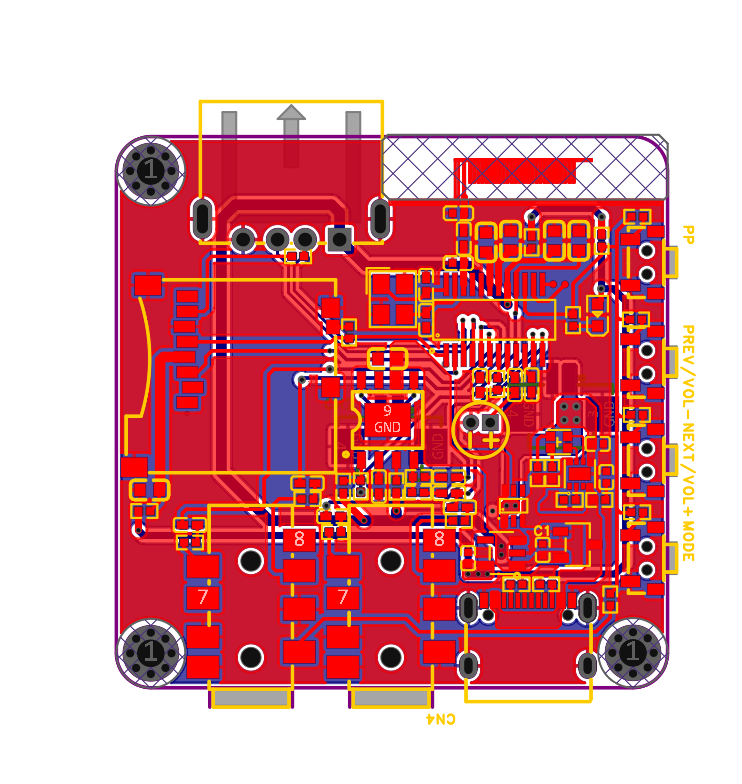
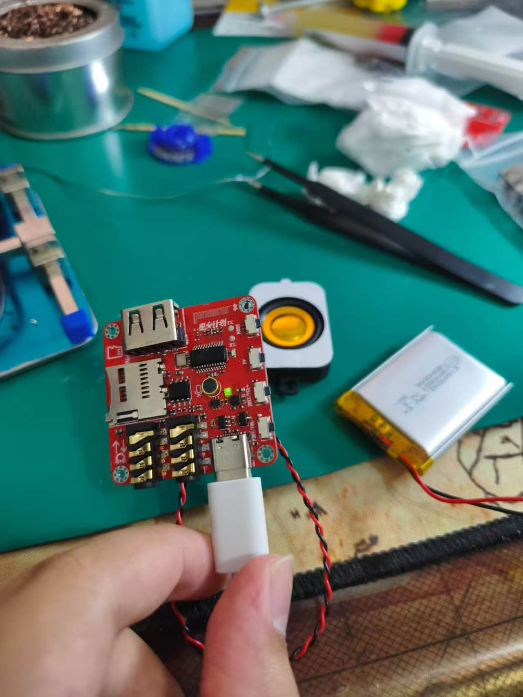
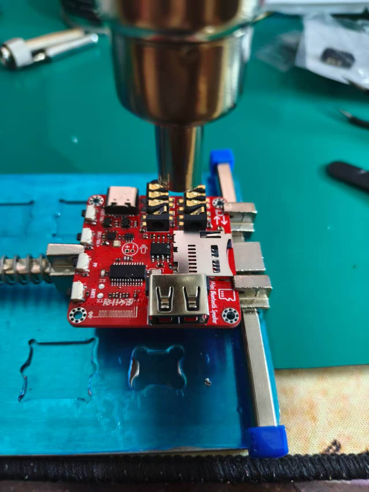
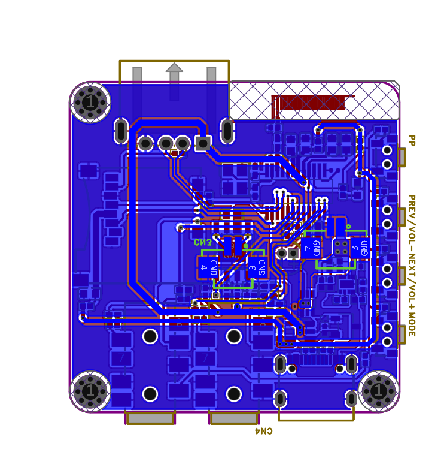
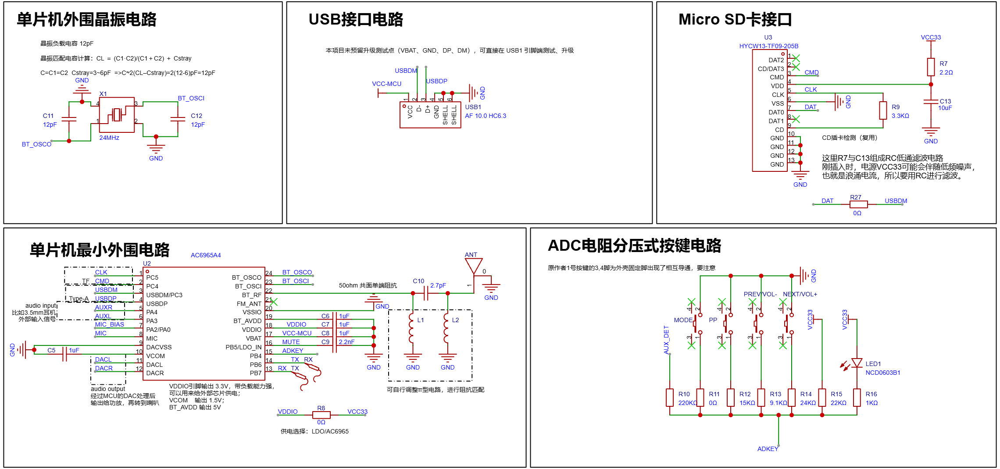
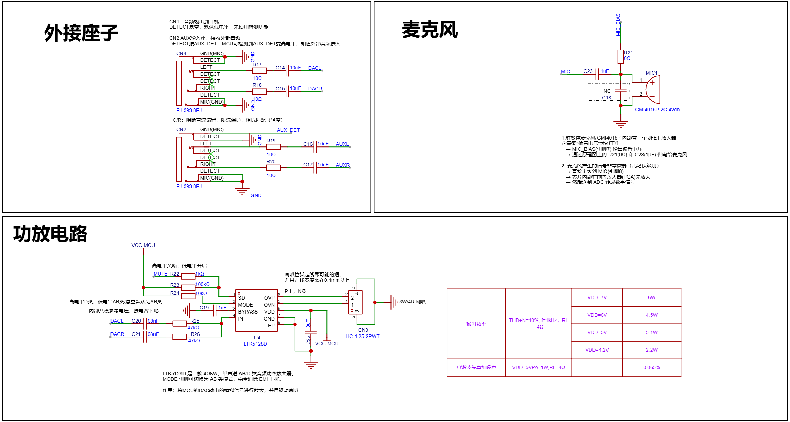
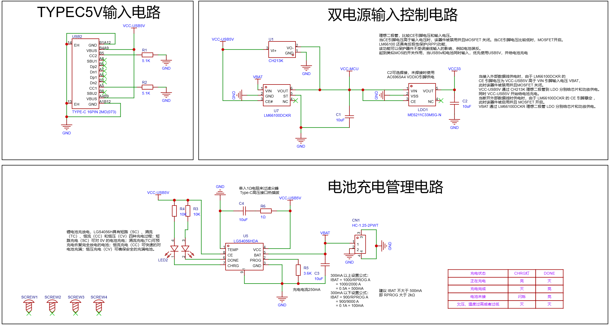

# 基于 AC6965A 的便携式蓝牙音箱（硬件复刻）

一块以 **杰理 AC6965A 单芯片蓝牙音频 SoC** 为核心的便携式蓝牙音箱完整硬件工程：原理图分析 → PCB 抄画 → 嘉立创打样 → 全贴片手工焊接 → 上电调试 → 蓝牙播放实测通过。

双层板、全板 0402 贴片，集成锂电池充电管理、电源路径切换、D 类功放、TF 卡/AUX/耳机接口与板载 2.4G 倒 F 天线。



---

## 功能特性

- **蓝牙音频播放**：手机搜索配对后可稳定连接、推送音乐，支持音量加减、上下曲按键
- **D 类功放扬声器输出**：LTK5128D，BTL 桥接直接驱动喇叭
- **锂电池充放电**：Type-C 输入，线性充电管理 + 电源路径自动切换
- **多音源接口**：TF 卡、AUX 线路输入、3.5mm 耳机输出（含插入检测）
- **板载射频**：2.4GHz 倒 F 天线 + π 型匹配网络，50Ω 共面波导馈线
- **Type-C 取电**：CC1/CC2 各 5.1kΩ 下拉（UFP 识别），支持充电宝直接供电

---

## 系统框图

```
                        ┌─────────────────────────────────────────────┐
 Type-C 5V ─ 充电管理 ──┤ VBAT 电池 / 系统供电                         │
 (LGS4056HDA)          │                    ┌──────────┐   DAC   ┌───┴────┐
                        └──────────────────►─┤ AC6965A  ├────────►│LTK5128D├──► 喇叭
                          电源切换 + LDO 3.3V │ 蓝牙SoC  │         │ D类功放 │
                        ┌──────────────────►─┤          │◄─ADC按键│        │
 TF卡 / AUX / 耳机 ─────┴────────────────────┤          │         └────────┘
                                             │ 24MHz晶振│
 板载倒F天线 ◄── 50Ω CPW + π匹配 ────────────┤ BT_RF    │
                                             └──────────┘
```

## 关键器件

| 器件 | 型号 | 作用 |
|:---|:---|:---|
| 主控 | AC6965A（杰理，QSSOP24） | 蓝牙 5.x 音频 SoC，集成 RF/Codec/MCU |
| 功放 | LTK5128D（ESOP-8） | 3W D 类音频功放，BTL 输出，带静音控制 |
| 充电 IC | LGS4056HDA | 单节锂电池线性充电（TP4056 兼容） |
| 电源切换 | 负载开关 / 理想二极管方案 | USB 与电池自动切换、防倒灌 |
| LDO | ME6211 | 3.3V 系统供电 |
| 接口 | Type-C 16P、TF 卡座、PJ-393 ×2 | 供电/数据、TF、AUX 与耳机 |

---

## 实物与设计图

| 焊接完成实物 | 上电测试 |
|:---:|:---:|
|  |  |

| PCB 顶层 | PCB 底层 |
|:---:|:---:|
|  |  |

| 主控电路 | 音频电路 | 电源电路 |
|:---:|:---:|:---:|
|  |  |  |

---

## 实测验证

全板焊接完成后实物测试，**手机蓝牙配对、音乐播放、按键控制全部通过**：

| 测试项 | 结果 |
|:---|:---|
| Type-C 5V 上电（充电宝供电） | ✅ 指示灯正常，无异常发热 |
| 双电源切换（USB 输入 / 锂电池） | ✅ 自动切换正常 |
| 手机蓝牙搜索 / 配对 / 连接 | ✅ 稳定连接 |
| 音乐播放（SoC DAC → D 类功放 → 喇叭） | ✅ 喇叭正常出声 |
| ADC 电阻分压按键（音量 +/−、上一曲/下一曲） | ✅ 逻辑全部正确 |
| ADC 按键模式切换 | ✅ 实际使用正常 |
| 充电回路（经一次芯片短路故障、洗板后恢复） | ✅ 电压正常 |

焊接与调试全过程（含充电芯片短路、助焊剂残留漏电、缺料替代等问题的排查）记录在 [Verification/焊接记录.md](Verification/焊接记录.md) 与 [Verification/测试记录.md](Verification/测试记录.md)。

---

## 焊接工艺

- **热风枪 + 电烙铁**完成全板焊接，未开钢网
- 热风枪负责 QSSOP24 / ESOP-8 芯片与接口座的回流，电烙铁用于局部补焊与修整
- 无钢网方案：注射器 + 细针头逐焊点涂锡膏，0402 阻容逐颗贴装
- 分 4 批焊接（电源 → 主控 → 音频 → 射频/接口），每批先测电压再继续

## 目录结构

```
├── README.md
├── Hardware/
│   ├── Schematic/        # 三页原理图 PDF（主控 / 音频 / 电源）
│   ├── Images/           # PCB 顶层、底层与原理图 PNG
│   └── BOM/              # 物料清单（含嘉立创下单 BOM）
├── Docs/                 # 学习笔记：电源/音频/射频原理、PCB 布局布线规则、面试问答
└── Verification/         # 焊接记录、测试记录（实测）
```

## 设计工具

- 原理图 / PCB：嘉立创 EDA（双层板，1.6mm，1oz 铜厚）
- 制板：嘉立创 PCB 打样
- 焊接：热风枪 + 电烙铁 + 针头点涂锡膏

---

## 声明

- 本项目为个人**硬件学习复刻作品**，参考开源 Mini Bluetooth Speaker 工程进行原理图分析与 PCB 抄画，仅供学习交流使用。
- 原厂芯片数据手册、SDK 与封装库等第三方版权资料未包含在本仓库中。
- 如内容涉及侵权，请联系作者处理。
